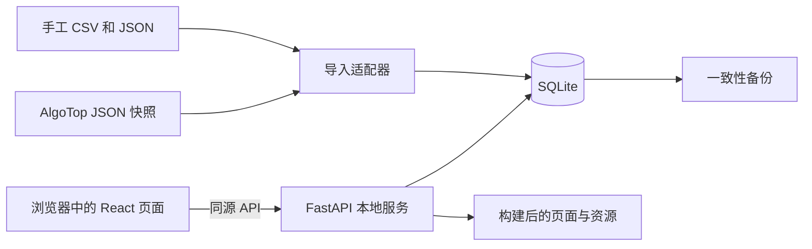

# CodeTop 个人本地刷题网站技术与数据方案

日期：2026 年 10 月 21 日。适用场景：Windows 单机、个人刷题、记录笔记和安排复习。

推荐以 AlgoTop 为前端基础，沿用 React、TypeScript、Vite，增加 Python FastAPI 服务和 SQLite 数据库。首批题库从 AlgoTop 的固定 JSON 快照导入，个人学习数据由本地服务保存。日常运行只启动一个本机服务，浏览器访问同一地址即可。

“数据库来源”分成两件事：SQLite 是保存数据的软件；AlgoTop JSON、补充 CSV 和手工录入是题库内容来源。公司频次属于来源快照中的统计数据，个人刷题次数属于自己的练习记录，两者分别保存。

## 使用目标与实现范围

第一版交付以下闭环：按公司和题目条件选题，查看题面或打开原题，记录练习结果，保存笔记和代码，在到期日进入复习列表，导出和恢复完整数据。

保留 AlgoTop 已有的公司、部门、岗位、难度和标签筛选，以及笔记编辑体验。增加今日复习、来源日期、完整备份和恢复。账号与云同步暂不纳入第一版；页面在本机使用，练习代码通过原题网站提交。

验收以数据持久性为核心：关闭浏览器和服务后重新启动，笔记、练习历史、掌握程度和复习日期均可恢复；更新题库后这些记录继续关联原来的题目。

## 技术选择

| 部分 | 选择 | 具体用途 |
| --- | --- | --- |
| 页面基础 | AlgoTop 的 React、TypeScript、Vite | 复用筛选、题表、主题、代码编辑和笔记界面 |
| 前端依赖管理 | Bun 与上游 bun.lock | 冻结依赖，使用 frozen lockfile 安装 |
| 前端构建环境 | Node.js 24 LTS | 开发和打包使用，日常运行只需 Python 服务 |
| 前端数据请求 | 沿用 TanStack Query | 查询缓存、刷新和写入后的状态同步 |
| Python 运行环境 | Python 3.12 独立虚拟环境 | 与电脑已有 Python 项目隔离 |
| 本地 API | FastAPI、Pydantic、Uvicorn | 查询题库、保存学习数据、处理导入与备份 |
| 数据访问 | SQLAlchemy 2.x 同步接口 | 请求级会话、显式事务和参数化查询 |
| 结构迁移 | Alembic | 管理数据库版本，迁移前生成备份 |
| 数据库 | SQLite，Python sqlite3 驱动 | 单机持久化，一个逻辑数据库 |
| HTML 展示 | DOMPurify | 净化来源题面和笔记渲染后的 HTML |
| 后端验证 | pytest、FastAPI TestClient | 验证导入、身份映射、持久化、复习和恢复 |
| 日常启动 | PowerShell 启动脚本 | 校验环境、检查端口、启动服务、打开页面 |

AlgoTop 当前依赖声明为 React 18、TypeScript 5、Vite 5，并使用 TanStack Query 和 CodeMirror。实施时固定选用的上游提交和锁文件，先建立构建基线，再单独处理依赖兼容性；不把 package.json 的版本范围视为最终安装版本。[上游依赖文件](https://github.com/dogxii/algoTop/blob/main/package.json)

构建环境选 Node.js 24 LTS，配合 Bun 管理上游锁文件，具体补丁版本纳入环境清单。[Node.js 发布状态](https://nodejs.org/en/about/previous-releases)

后端依赖在首次兼容性验证后锁定具体补丁版本并记录 Python 和 SQLite 实际版本。SQLite 表结构变更使用 Alembic 支持的迁移机制；每次升级都通过已有数据的升级验收。[SQLAlchemy SQLite 支持](https://docs.sqlalchemy.org/en/20/dialects/sqlite.html)、[Alembic SQLite 迁移](https://alembic.sqlalchemy.org/en/latest/batch.html)

HTML 采用白名单处理，去除脚本、事件属性和危险链接协议；保留段落、列表、代码和必要的题面结构。[DOMPurify](https://github.com/cure53/DOMPurify)

另外两条路线的取舍如下：原样运行 AlgoTop 最快，但学习记录仍由浏览器管理；全新开发 Vue 页面更自由，但要重新实现现有题表、编辑器和筛选交互。本方案保留现有页面，通过本地 API 获得独立文件存储。

## 本地运行架构



开发时，Vite 运行在 127.0.0.1:5173，将 `/api` 代理到 127.0.0.1:8000。日常使用时，FastAPI 同时提供 `/api/v1` 和构建后的页面，只需一个监听 127.0.0.1 的服务进程。静态资源在本地打包，页面导航回退与 API 路由分开处理，未知 API 返回 JSON 404。[FastAPI 静态文件支持](https://fastapi.tiangolo.com/tutorial/static-files/)

数据库路径通过绝对配置解析，不随启动脚本的当前目录变化。写操作要求同源校验与本地会话令牌，生产配置不开放任意来源的 CORS。此方案的访问边界是本机回环地址。

首次安装、依赖下载和主动更新题库需要网络。安装完成后，本地题库文字、笔记、记录、统计和复习列表可以离线使用；原题网站、外链题目和题面外链图片仍需联网。第一版不把外链图片计入离线完整性承诺。

## 首批题库来源

主来源采用 [dogxii/algoTop](https://github.com/dogxii/algoTop) 仓库中的 [public/data/codetop.json](https://github.com/dogxii/algoTop/blob/main/public/data/codetop.json)。上游说明其灵感和数据来自 CodeTop，文件本身包含题目、分类字典和统计索引。[上游说明](https://github.com/dogxii/algoTop#readme)

本次读取的文件信息如下，下载检查日期为 2026 年 10 月 21 日：

| 项目 | 数值 |
| --- | --- |
| 文件内 generatedAt | 2026-07-18T14:29:48.365Z |
| 文件大小 | 3,565,224 字节 |
| 题目 | 1,153 道 |
| 公司 | 22 家 |
| 部门 | 571 个 |
| 岗位 | 8 类 |
| 标签 | 38 类 |
| 所有维度索引记录合计 | 21,906 条 |
| 索引中找不到对应题目的记录 | 0 条 |

该快照的 SHA256 为：

```text
BC496564C4939EAE1173636DEC05B358B0A46B0B6DD1797D3FF10416DBC81AC9
```

这些数字描述这一份快照，不代表 CodeTop 当前全部数据或 GitHub 后续版本。应用显示“数据生成日期”和“本机导入日期”两个字段，下载日期不能替代来源数据日期。

主数据的根字段为 `generatedAt`、`source`、`taxonomies`、`questions`、`indexes`、`stats`。其中 questions 是按来源内部编号索引的对象，不能按数组直接处理。

## 题目标识和导入字段

每道题分配本系统 UUID，个人笔记和历史只关联这个 UUID。另用来源映射表保存上游身份，重复导入通过映射找到同一题。

| 原字段 | 本地含义 | 映射规则 |
| --- | --- | --- |
| questions 对象键与题目 id | CodeTop 内部题目编号 | 字符串保存，建立来源身份映射 |
| displayId | 展示编号 | 字符串保存，允许 3、LCP 09、面试题和补充题等格式 |
| questionId | 上游另一个题目标识 | 单独保存为 upstream_question_id |
| title | 题目标题 | 原样保留文字 |
| level | 难度 | 1 简单，2 中等，3 困难；其他值报校验错误 |
| content | 题面 HTML | 允许为空，展示前净化 |
| slug 与 expandedLink | 原题地址材料 | 常规题构造力扣地址；完整外链按外链保存；空值保留 |
| taxonomies | 公司、部门、岗位和标签字典 | 按类型和来源键导入，部门保留所属公司 |
| indexes | 不同范围的题目列表和频次 | 导入带统计范围的快照记录 |

实际例子：题目“无重复字符的最长子串”的来源 id 为 1681，displayId 为 3。indexes 内 questionId=1681 指向来源 id，而不是直接指向题目字段 questionId 或力扣展示编号。

身份合并采用以下规则：

1. 同一来源通过 `(source_name, source_record_id)` 找到已有 UUID。
2. 跨来源合并只对能明确识别的常规力扣题使用经规范化的题号作为依据；公司名通过显式别名表对齐，例如 ByteDance 与字节跳动。
3. 补充题、外链题、无法识别的题目保留独立身份。没有精确依据的跨源匹配进入预览列表，由用户选择关联。
4. 标题和 slug 不作为全局唯一键。这份快照中 `sort-an-array` 对应四条题目记录，包含不同的补充练习。

本快照有 21 道题缺少题面、7 道题缺少 slug。缺失字段保留为空，页面允许写个人笔记和记录练习；缺少地址时不生成猜测链接。

## 公司频次与筛选的统计规则

indexes 提供 overall、companies、departments、jobs 和 tags 五类独立索引。各类记录包含 questionId、frequency、time 和 commentCount。将 time 保存为来源的最近考察时间，不作为每一次考察的事件明细。

首页默认使用 overall 的 frequency 排序。选择公司后使用该公司的 frequency；选择部门后使用部门的 frequency；单独选择岗位时使用岗位的 frequency。标签和难度只筛选题目，不额外累计频次。所有排序在频次相同时按展示编号和本地 UUID 确定稳定顺序。

同时选择公司与岗位时，可取两者题目集合的交集，页面明确标注“公司题单与岗位题单的交集，频次按公司统计”。这不表示这些题目被证实在该公司的这个岗位考过。选择部门和岗位时同理。若需要精确的“公司加岗位”题单，需要另行引入包含联合维度的来源。

“最近三个月考察过”只根据 last_seen 与日期阈值比较。数据没有逐次考察事件，因此这个筛选下仍显示来源原有累计频次，列名为“累计频次”，不显示“近三个月次数”。界面同时保留快照日期，避免把历史快照解读为实时排行。

不同来源分别显示其原始统计范围与单位。CodeTop 累计频次与其他来源的频率百分比不相加，不平均，也不进行全局混排。

## 补充数据来源

| 来源 | 用途 | 接入方式 |
| --- | --- | --- |
| AlgoTop 固定 JSON | 首批中文题库、公司与岗位题单 | 第一版必做适配器 |
| 自己维护的 CSV 或 JSON | 补充面试题、题集和元数据 | 第一版提供预览导入 |
| liquidslr/leetcode-company-wise-problems | 可选的其他公司题单 | 第二阶段独立适配器与来源切换 |
| 原题网站 | 提交答案、查看缺失题面 | 题目链接跳转 |

[liquidslr 数据仓库](https://github.com/liquidslr/leetcode-company-wise-problems) 提供按公司组织的题目文件，其更新说明存在历史日期；每次使用以实际文件、提交和导入时间记录为准。它作为另一个数据源使用，不直接覆盖 CodeTop 题单。

CSV 适配器识别文件实际表头，映射题号、标题、难度、URL、标签与频率。保留 `frequency_kind`、原始 frequency 值、统计窗口和原始列名；只有来源明确说明的单位才转换，无法确认时标为 source_score。未提供岗位或部门的来源不能生成对应关系。该来源按一次完整仓库快照导入多个公司和统计窗口，形成一个数据集，避免导入单个公司时替换其他公司题单。

手工导入格式至少支持以下字段：

```text
platform,display_id,title,difficulty,url,tags,collection
leetcode,3,无重复字符的最长子串,medium,https://leetcode.cn/problems/longest-substring-without-repeating-characters/,字符串|滑动窗口,面试准备
```

CSV 导入针对题库元数据。笔记、练习历史和复习状态通过完整备份格式迁移，避免把空白列当成清空已有个人记录的指令。

首期运行不依赖在线抓取 CodeTop 或力扣接口。保存来源说明与代码许可证文件；题面和统计数据保留原始归属信息，代码的开源许可不自动作为第三方数据许可的说明。

## 数据库模型

使用单个 `study.sqlite3`。来源内容按数据集版本保存；个人数据按稳定题目 UUID 保存。题库版本切换只改变所展示的来源内容。

| 表 | 主要字段 | 约束或作用 |
| --- | --- | --- |
| source_datasets | id、source_name、sha256、generated_at、imported_at、source_url、source_commit、status、summary_json | source_name 与 sha256 唯一；保存原始字段和统计列定义；文件导入无提交号时 source_commit 为空 |
| problems | id、canonical_platform、canonical_key、kind、created_at | 稳定题目身份；明确的常规力扣题使用 platform 与 canonical_key 的组合唯一约束 |
| problem_source_keys | source_name、source_record_id、problem_id、upstream_question_id | source_name 与 source_record_id 唯一 |
| catalog_entries | dataset_id、problem_id、display_id、title、difficulty、content_html、slug、expanded_link、url | dataset_id 与 problem_id 唯一；保存该版本的题目内容 |
| taxonomies | dataset_id、type、source_key、name、parent_company_key | 组合唯一；公司、部门、岗位、标签、手工题集及 overall 哨兵分类 |
| scope_stats | dataset_id、problem_id、scope_type、scope_key、window_key、frequency_value、frequency_kind、last_seen、comment_count | 保存来源范围及统计窗口内的题单成员与统计 |
| study_state | problem_id、mastery、favorite、review_enabled、review_step、next_review_date、last_advanced_date、revision、updated_at | 每题一行；掌握程度、暂停复习状态和复习安排 |
| practice_logs | id、problem_id、request_id、practiced_at、outcome、duration_seconds、scheduler_version | request_id 唯一；保留每次练习 |
| notes | problem_id、body_md、code_text、language、revision、updated_at | 每题一份当前笔记；使用 revision 防止多标签页覆盖 |
| settings | key、value_json | 时区、复习间隔、可见来源和界面偏好 |

scope_stats 的唯一键为 `(dataset_id, problem_id, scope_type, scope_key, window_key)`。overall 的 scope_key 固定为 `all`，其他维度用对应分类键；CodeTop 原始累计统计的 window_key 固定为 `cumulative`，其他来源保留各自的窗口键，所有唯一键成员均不可为空。

导入时将 companies、departments、jobs、tags 统一映射为 company、department、job、tag，并为每个数据集增加一个内部 overall 分类，其 source_key 为 all。由此 scope_stats 可以用 `(dataset_id, scope_type, scope_key)` 外键引用 taxonomies；内部哨兵不计入来源分类数量。题单成员还用 `(dataset_id, problem_id)` 引用 catalog_entries，分类父子关系由校验器验证属于同一数据集。没有统计值的题单成员可以用 NULL 表示，NULL 与 0 含义不同。

为范围频次查询建立 `(dataset_id, scope_type, scope_key, window_key, frequency_value DESC)` 索引；为复习建立 `study_state(next_review_date)` 索引，为活动统计建立 `practice_logs(practiced_at)` 和 `(problem_id, practiced_at)` 索引。组合筛选使用 EXISTS 或去重的题目集合，避免多标签关联使题数和频次重复计算。

开启 foreign_keys、合理的 busy_timeout 和 WAL；采用请求级会话与短事务，日常服务使用一个 worker。WAL 数据库放在本机磁盘，备份由应用创建一致性快照。[SQLite WAL 说明](https://sqlite.org/wal.html)

## 数据导入与更新流程

导入入口接收本地文件或受控来源下载的快照，保存原始字节与 SHA256，形成可追溯来源。源文件按内容哈希命名，同一来源和同一哈希重复导入直接返回已有结果。

一次更新分为以下阶段：

1. 解析并校验结构、难度枚举、题目标识、分类字典、索引外键与重复记录。
2. 展示来源生成日期、新增与变更数量、无法匹配的题目、缺少题面和链接的记录，以及统计维度。
3. 用户应用后，创建更新前备份，在事务内写入新版本题目、分类、统计与来源身份映射。
4. 校验新版本的记录数与外键，原子切换该来源的 active 数据集。对 status 为 active 的 source_name 建立条件唯一索引，一个来源同时只能有一个 active 版本。
5. 失败则回滚此次应用，继续使用原版本；记录错误详情供检查。

更新只写来源数据，不修改 notes、practice_logs 或 study_state。新快照未包含旧题时，旧题继续保留在个人记录和全部历史题目入口中，不执行级联删除。用户可切回旧数据集查看当时的题单；题库内容以 catalog_entries 中对应版本为准。

原始文件、导入结果和版本清单共同支持重复导入、来源比对和后续回退。后台不自动批量清理源文件、备份或构建目录；需要批量清理时由用户手动操作。

## 前端改造与 API 边界

将题库查询和学习状态读写收敛到统一 API 客户端。AlgoTop 的 `src/hooks/useAlgoTopQuery.ts` 改为读取本地服务；`src/App.tsx` 中的进度 localStorage 读写改为 API 调用。主题和临时筛选偏好可以继续保存在浏览器。

写笔记采用短延迟自动保存和 revision 校验，界面显示保存中、已保存或失败，失败时保留编辑内容。写练习记录携带 request_id，双击或网络重试只生成一条记录。更新成功后按题目和统计范围失效 TanStack Query 缓存。

| API | 作用 |
| --- | --- |
| GET /api/v1/health | 启动检查，返回应用和数据库结构版本 |
| GET /api/v1/catalog/datasets | 列出来源版本、快照日期和启用状态 |
| POST /api/v1/catalog/datasets/{id}/activate | 原子切换该来源的活动版本，支持回退 |
| GET /api/v1/catalog/taxonomies | 返回当前来源的筛选字典 |
| GET /api/v1/problems | 搜索、组合筛选、稳定排序和分页 |
| GET /api/v1/problems/{id} | 题面、来源、个人状态与笔记 |
| PATCH /api/v1/problems/{id}/state | 修改掌握程度、收藏和复习启用状态 |
| PUT /api/v1/problems/{id}/note | 带 revision 保存笔记和代码 |
| POST /api/v1/problems/{id}/attempts | 幂等写入练习记录，同时更新复习日期 |
| GET /api/v1/reviews/due | 按本地日期取到期题目 |
| POST /api/v1/imports/preview | 校验文件并提供差异预览 |
| POST /api/v1/imports/{id}/apply | 应用已校验的导入 |
| POST /api/v1/backups | 生成完整备份并返回下载信息 |

查询响应同时返回 ranking_scope、window_key、frequency_kind、source_generated_at，前端据此展示频次口径。所有写入先完成数据库事务，再返回成功。常见错误使用 422 表示校验失败、409 表示 revision 或来源冲突；数据库暂时繁忙时返回明确的重试提示。

从旧版 AlgoTop 迁移学习数据时，由旧页面所在浏览器来源导出，再在新页面导入预览。浏览器存储按来源隔离，新的 127.0.0.1:8000 页面不能直接读取旧 localhost:5173 页面的记录。迁移按来源内部题号映射；原页面数据保留，直到新系统核对成功。

## 复习安排

第一版使用可解释的固定间隔，默认 1、3、7、14、30 天。练习结果分为独立完成、使用提示、查看答案和未完成。独立完成逐级推进；其余结果将级别重置并安排次日复习。一次练习记录和对应状态更新在同一个事务提交。

首次独立完成进入第一级，次日到期；后续每次在新的本地日独立完成，依次推进到 3、7、14、30 天，最高级保持 30 天。同一天再次独立完成仍记录历史，但不再次推进级别；同一天失败仍会重置级别。所有日期以 Asia/Shanghai 计算，练习事件时间使用 UTC 保存。

掌握程度由用户主动标记，取值为 0 未评估、1 生疏、2 基本掌握、3 熟练，与练习结果分别保存。是否做过由练习历史判定。首次记录练习默认启用复习，之后可以通过 review_enabled 暂停；暂停时保留原日期但不进入到期列表，恢复时若已过期则立即进入到期列表。掌握标记本身不默默删除复习安排。调度器记录 scheduler_version，未来更换算法时可以解释旧记录。

## 部署目录与启动方式

建议独立应用目录为 `D:\my_develop\algotop-local`。这是后续部署的目标目录，方案文档保存在当前面试准备工作区。

```text
algotop-local/
  frontend/                    AlgoTop 页面代码
  backend/
    app/                       API、模型与服务
    migrations/                Alembic 迁移
    tests/                     关键业务验证
  data/
    study.sqlite3              学习与题库数据库
    sources/                   原始来源文件与版本清单
    backups/                   完整备份
  releases/                    按版本保存前端构建产物
  scripts/
    setup.ps1                  初次安装和初始化
    build.ps1                  构建前端
    start.ps1                  日常启动
    backup.ps1                 一致性备份
    restore.ps1                停服校验后恢复
```

前端源码、后端源码和迁移纳入版本控制；数据库、个人笔记导出、备份、日志与虚拟环境加入忽略规则。升级构建写入新版本目录，并切换所服务的目录，保留旧版本供回退。

日常启动脚本先定位绝对应用目录，检查数据库迁移版本和 8000 端口，再启动 Uvicorn，健康检查成功后打开浏览器。若相同应用已经运行，打开已有页面；若端口被其他程序占用，给出明确提示。后台辅助进程保持隐藏窗口，并记录日志位置。

后端入口按 `backend/app/main.py` 中的 app 设计。在 backend 目录下，等价的服务命令为：

```powershell
.\.venv\Scripts\python.exe -m uvicorn app.main:app --host 127.0.0.1 --port 8000 --workers 1
```

打开 [本地网站](http://127.0.0.1:8000)。日常使用运行构建产物，依赖开发服务器的启动方式只用于开发。[Uvicorn 启动说明](https://fastapi.tiangolo.com/deployment/manually/)

## 备份与恢复

应用通过 Python sqlite3.Connection.backup 创建数据库一致性快照，随后检查 quick_check 和外键。备份包包含数据库快照、来源版本清单、所引用的原始来源文件、应用版本和文件哈希；当前版本没有单独上传附件目录。[SQLite 备份机制](https://www.sqlite.org/backup.html)、[Python sqlite3](https://docs.python.org/3/library/sqlite3.html)

提供一键备份；数据库迁移、应用新题库版本和恢复旧备份前自动生成备份。每天首次启动时，若当天尚无自动备份则生成一份。备份全部保留，界面显示数量与占用空间，批量清理由用户手动完成。

恢复通过本机脚本执行：停止本应用服务，先备份当前数据库，解包到临时路径并检查路径范围、哈希、SQLite 完整性和结构版本，然后恢复到应用数据目录。原数据库保留为明确命名的回退文件；失败时重新使用原文件。恢复成功后核对题目、笔记、练习历史和复习记录数量，再重新启动。

## 实施阶段与验收

| 阶段 | 交付 | 验收 |
| --- | --- | --- |
| 一 | 固定上游版本、前端构建、本地服务、SQLite 初始迁移和 JSON 导入 | 当前快照导入 1,153 题；21,906 条索引引用均有效；断网可以浏览已有文字题库 |
| 二 | API 持久化、笔记、掌握程度、练习历史和浏览器数据迁移 | 重启后记录不丢；同一请求重复提交只生成一条练习；笔记版本冲突可见 |
| 三 | 今日复习、复习间隔、活动统计 | 跨日和同日多次练习符合调度规则；公司加岗位的展示口径准确 |
| 四 | 更新预览、来源回退、完整备份、恢复和启动脚本 | 重复导入无重复；更新不改个人数据；失败导入保持旧版本；备份可在新数据目录恢复 |
| 后续 | 补充公司 CSV 适配器、手工题集扩展 | 跨来源单位分别展示；无法精确匹配的题目进入人工预览 |

关键业务验证覆盖内部编号与展示编号不同、共享 slug 的补充题、缺少题面或 URL、混合筛选重复计数、同哈希重复导入、事务回滚、幂等练习写入、时区跨日、更新保留个人数据，以及备份恢复。页面验收覆盖题目筛选、笔记保存失败提示、复习完成和来源日期显示。

完整交付时应包含可双击启动的本机应用、锁定依赖与来源版本的清单、首批题库、迁移脚本、备份恢复脚本和使用说明。后续开发以本方案为设计输入，再拆分到可执行的实现任务。
