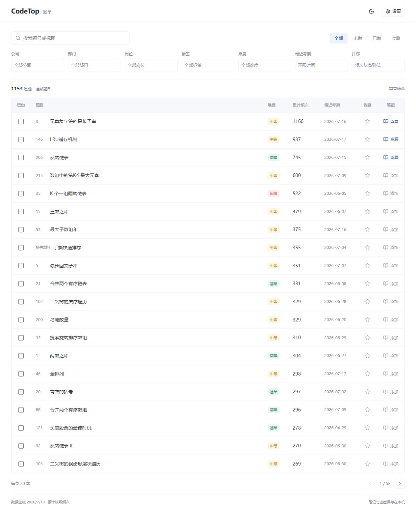
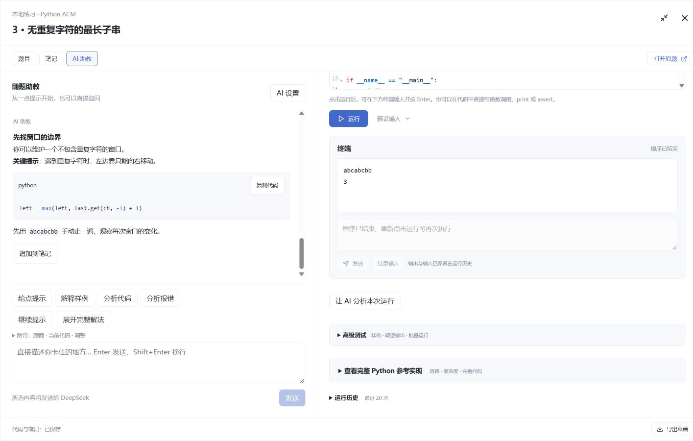

# CodeTop Local

**把高频选题、本地读题、Python 练习、笔记和 AI 助教放在一起的个人刷题工具。**

准备算法面试时，按目标公司、部门、岗位和考察频次筛题，在浏览器里直接读题、写代码、记笔记，学习记录保存在自己的电脑上。

[快速开始](#快速开始) · [部署与常见问题](docs/deployment.md) · [详细使用手册](docs/user-guide.md) · [第三方来源](THIRD_PARTY_NOTICES.md)

## 能帮你做什么

| 你想做的事 | CodeTop Local 提供的功能 |
| --- | --- |
| 找到值得优先练的面试题 | 按公司、部门、岗位、标签、难度、最近考察筛选，按累计频次排序 |
| 把刷题过程集中在一处 | 本地题面、代码编辑、交互终端、自定义样例和代码历史 |
| 留住自己的学习积累 | 已做标记、收藏、Markdown 笔记、草稿自动保存、完整备份与恢复 |
| 卡住时获得提示 | 可选 DeepSeek AI 助教，结合题面和代码解释样例、分析报错、给出提示 |
| 使用自己的题单 | CSV / JSON 导入预览、题库来源和版本切换 |

内置固定快照包含 **1,153 道题**，其中 **1,132 道有本地题面**。数据生成于 **2026-07-18**，展示的是来源快照的累计频次，不是实时排名。

## 界面预览

**高频题单：筛选、进度、收藏和笔记**



**练习与随题 AI 助教**



AI 截图用于展示交互效果；实际回答需要自行配置 Key 并联网。

## 快速开始

适用于 **Windows 10 / 11 x64**。

1. 打开 [最新版本下载页](https://github.com/lv-xiaoke/code_platform/releases/latest)，下载 `CodeTop-Setup-*-windows-x64.exe` 安装包。
2. 双击安装包，按向导完成安装。
3. 双击桌面的 **CodeTop 刷题**，即可开始使用。

macOS 适配代码及构建入口已加入，当前尚无经过 Mac 实机验收的正式安装包。维护者可在 Mac 上构建 Apple Silicon / Intel 测试包，详见[macOS 构建与使用](docs/deployment.md#macos-构建与使用)和[验收记录](docs/macos-validation.md)。

## 数据、备份与更新

学习数据库、笔记、代码历史和自动备份保存在项目目录的 `data/` 中。初始化重复执行会保留已有学习数据。安装目录内会持续产生数据，请放在可写的本地目录。

- **备份**：页面“设置 → 完整备份”，或运行 `scripts/backup.ps1`。
- **升级**：先生成完整备份，在新目录安装新版，再恢复备份；AI Key 需要重新配置。
- **离线使用**：首次安装完成后，内置题库、笔记、进度可离线使用；运行代码需已准备好 Docker 镜像；AI、外部原题和下载依赖需要联网。

恢复步骤、换端口、日志位置和故障处理见[部署说明](docs/deployment.md)。

## 开发与生成体验包

技术栈：React + TypeScript + Vite、FastAPI + SQLAlchemy + SQLite，Python 代码支持本机执行和可选的 Docker 模式。

完整桌面版用独立 CPython 子进程运行代码，以 Windows Job Object 管理资源及退出。维护者构建桌面安装包见[部署文档](docs/deployment.md#维护者构建完整桌面安装包)。

在源码安装完成后，于项目根目录运行：

```powershell
powershell.exe -NoProfile -ExecutionPolicy Bypass -File .\scripts\verify.ps1
powershell.exe -NoProfile -ExecutionPolicy Bypass -File .\scripts\package-release.ps1
```

第二条命令重新构建页面，在 `dist/` 生成 Windows ZIP 和 `.sha256` 校验文件。打包仅收录程序、当前前端构建、内置题库与文档，不携带本机学习库、Key、虚拟环境、日志或旧发布。体验包不是免安装离线包，首次使用仍需 uv 和网络。

开发服务器、测试选项和目录结构见[详细使用手册](docs/user-guide.md#开发与重装)。

## 来源与使用范围

项目面向个人本机学习，默认只监听 `127.0.0.1`，不提供账号、云同步或多人公网服务部署。

题库快照及部分前端代码来自 [AlgoTop](https://github.com/dogxii/algoTop)，上游采用 MIT 许可证；题目及原题链接保留其来源信息。详见[第三方来源与许可说明](THIRD_PARTY_NOTICES.md)。
