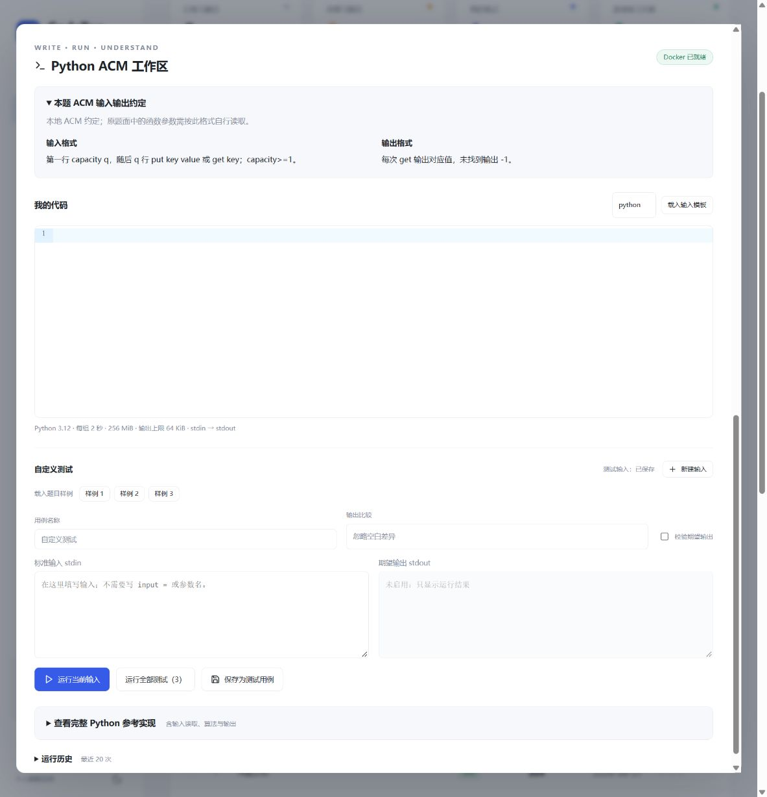

# Python ACM 验收记录（2026-10-21）

当前应用 1.1.0，结构 0002，部署根目录仍为 `D:\my_develop\A_work_program\code_platform`。发布目录为 `releases/20261021-150253-997-59bbd2`。正式服务地址 http://127.0.0.1:8000。

## 自动验证

设置 `CODETOP_DOCKER_TESTS=1`、`CODETOP_REFERENCE_TESTS=1` 后执行 `scripts/verify.ps1`：**52 项后端测试通过，3 项前端请求测试通过，TypeScript 检查通过**。`scripts/build.ps1` 构建成功。保留原测试客户端的弃用提示和上游 CodeMirror 静态/动态导入分块提示；均未导致验证失败。

覆盖比较模式、空期望输出、套件 revision 冲突、请求幂等及冲突、队列容量、服务重启中断标记、运行历史、备份、来源内部编号匹配，以及学习数据不被运行修改。实际 Docker 覆盖 Unicode、正确/错误输出、只运行、语法错误、运行异常、超时、输出洪泛、禁网、非 root/宿主数据库不可见，以及以下复核回归：

- 用例创建脱离进程组的后台进程，后续用例仍无残留进程。
- 多次 fork 后不 wait 的孤儿/僵尸进程完整回收，不耗尽后续用例的 PID 限额。
- 20 组各 60,000 个 NUL 的合法输出可完整传输；宿主捕获仍有按最大转义膨胀计算的有限上限。

后面三项在修复前均失败，修复后通过。监督程序仅允许作为专用 Docker PID 命名空间中的 PID 1 启动，逐组清理并回收后代；不会在宿主执行提交的程序。

## 参考实现

首批 50 份为本项目编写的完整 Python ACM 程序，按固定快照 overall 前 50 个来源记录编号绑定，包含补充题 1906。每题有明确 stdin/stdout 约定、算法、复杂度和至少三组样例/边界测试。**50 份程序共 152 组测试全部在固定 Docker 镜像通过**，实际 Python 3.12.15。

镜像：`python@sha256:2259debdc6af85626058a15a7bf44ad6a68b8c98c9ae82a02cf5cdb92f096d47`。源码/用例哈希与验证记录位于 `backend/reference_pack/verification.json`；执行器哈希见 `environment.json`。每次实际运行产物保留在 `runtime/tests` 下，不自动清理。

这些是本地学习参考实现与有限测试结果，未宣称原题平台隐藏测试 AC。其余 1,103 道题支持 Python 编程、自定义输入和测试集，暂未附本地参考代码或内置样例。

## 浏览器验收

全部写入型 UI 验收使用独立目录 `runtime/acm-acceptance`、端口 8001：

1. 编写完整 stdin/stdout Python 程序，输入自定义字符串 `Python ACM`，设置期望输出；显示 1/1 通过。
2. 修改为错误期望后重跑，显示“输出不符”及实际结果。
3. 展开完整参考代码并独立运行，4/4 内置测试通过，个人代码文本未变。
4. 保存自定义输入为测试，立即关闭并重开题目，草稿、期望输出和 5 组测试均保留；再次编辑、关闭重开无自身 revision 冲突。
5. 运行参考实现的全部测试，包含新保存的一组，5/5 通过；个人代码仍保持原样。
6. 控制台未出现错误。正式页面已刷新至新发布并展示 ACM 工作区，Docker 显示就绪；未向正式库写入演示代码、测试或运行记录。

## 数据和恢复

升级前人工备份：`data/backups/20261021T065233910239Z-manual-2737820f.zip`（0001）。迁移还自动创建了 before-migration 备份。升级后备份：`data/backups/20261021T070546728264Z-manual-a0ca2941.zip`（0002）。

原有 1 条笔记、0 条练习记录、0 条学习状态和 0 条设置，与升级前的完整有序行数组 JSON 哈希逐表相同；包括笔记、代码、语言和 revision，未只比较行数。指纹仅保存在本地 `runtime/acm-personal-baseline.json`、`runtime/acm-personal-verified.json`，不在文档复制笔记正文。

实际验收库完整备份恢复到 `runtime/acm-restore-6c48bd64bee142ebbeb4e1417725432b` 后，笔记 1 条、测试集 1 条、运行记录 4 条的完整行内容均一致，练习与学习状态仍为 0。证据为 `runtime/acm-backup-verified.json`。另有自动测试直接创建旧 0001 库、迁移、恢复旧备份并再次升级，验证原笔记内容/代码/revision 保留。

## 独立复核与限制

独立复核发现并修复了测试缓存过期、用例后代未回收、转义输出传输上限、测试集变化后复用旧重试身份四项 Important 问题。补充修复了延迟旧 GET 回退 revision 的竞态：保存成功先取消旧查询，再更新缓存；后台只接纳更大的 revision。最终限定复核无残留 Important/Critical 问题。

运行上限为每组 2 秒、容器 256 MiB、stdout/stderr 合计原始字节 64 KiB、每次 20 组；同时执行 2 项、最多 8 项未完成任务。容器禁网、只读、非 root，缺少 Docker 或镜像时显示错误，其他学习功能继续可用。当前只执行 Python。所有运行文件、备份、旧发布和测试目录均保留；需要批量清理时由用户手工操作。
