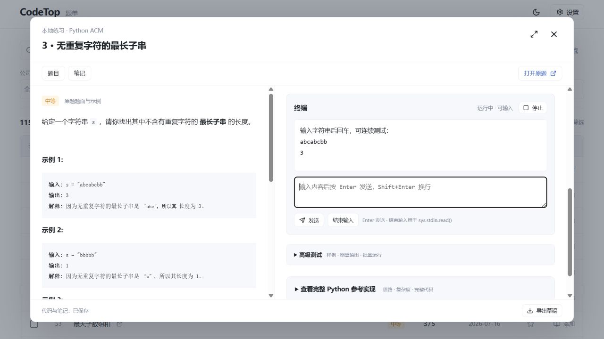

# 交互终端验收（2026-10-22）

应用 1.4.0，结构仍为 0002，无新依赖、无数据库迁移。正式发布 `releases/20261022-215306-965-e5de65`，地址 http://127.0.0.1:8000。

## 使用

默认“运行”启动交互 Python 进程，stdin 保持打开。终端可输入后按 Enter 或点击发送，支持连续输入、空行、中文和多行粘贴；Shift+Enter 换行。“结束输入”发送 EOF，供 `sys.stdin.read()` 等程序读完；“停止”终止程序。关闭练习也会先停止活动终端，再保存代码和测试草稿。页签切换保留终端，发送时输入框只读以保留键盘焦点。

stdout/stderr 和不带换行的提示增量显示，输入与输出进入运行历史、完整备份。旧“自定义输入”入口现称“预设输入”，保留一次性 stdin 批量运行；高级测试、参考代码及旧历史继续可用。

## 自动验证

设置 `CODETOP_TERMINAL_TESTS=1` 后执行 `scripts/verify.ps1`：**56 项后端测试通过、24 项前端测试通过、TypeScript 检查通过**。其中包含真实 Docker 终端测试。13 项旧执行器／参考全集可选测试未启用，未改动旧监督程序与参考算法；保留原 Starlette/httpx 弃用提示。最终生产构建成功。

新增 API 测试先因终端接口缺失失败，再验证连续输入、EOF、重试幂等（含完成后的重试）、启动请求取消、容量、跨来源写入拒绝、输入预算、停止与历史持久化。新增前端测试覆盖行结束符、空行／中文／空白、幂等身份、活动／结束状态、纯文本输出和发送时保留焦点。

真实容器覆盖：

- 程序等待输入超过原批量执行的两秒限制后继续运行；不换行的中文提示、两次输入、EOF 均正确。
- 非 root、禁网、不可见宿主数据库；停止后仅本次容器被移除，后台子进程不残留。
- 运行异常、64 KiB 输出限制、累计计算 CPU 限制。
- 子进程不能打开监督进程 `/proc/1/fd/0`、`/proc/1/fd/1` 伪造协议。

只读复核发现每进程 CPU 限制不足以约束整个进程树；真实测试先复现多次短子进程可绕过预算，再增加私有 cgroup 的累计 CPU 统计，测试通过。复核建议的监督通道探针也真实复现了同 UID 文件描述符访问，已将监督进程设为不可 dump，回归测试通过。前端发送时失去键盘焦点的问题同样先复现，再以只读代替禁用，回归及浏览器检查通过。

## 浏览器验证

全部写入使用独立 `runtime/terminal-acceptance`、端口 8001，前端预览位于 `runtime/terminal-preview`；验收期间正式页面未切换到未完成的接口。

1. 使用题目 3 的 `sys.stdin.readline()` 程序：运行后保持等待，无输入时不提前输出 0；输入 `abcabcbb` 回车后得到 3。
2. 两个 `input()` 提示连续接收“你好”“世界”，输出正确；第一行发送后焦点仍在终端输入框。
3. `sys.stdin.read()` 接收 `one\ntwo\n`，点击结束输入后才读完并打印完整文本。
4. 停止启动中的程序成功；活动终端关闭练习后，数据库记录为 completed、程序状态 stopped，无残留任务。
5. 原参考程序全部 4 组内置测试真实运行，4/4 通过。
6. 连续字符串测试在得到 3 后继续等待下一行。390px 视口文档宽度仍为 390px，终端未溢出；临时视口已恢复。浏览器无 error/warn。
7. 正式页面已确认提供新的运行入口与预设输入入口；正式库不写演示代码、输入和运行记录。

## 生命周期与数据

交互程序始终在固定 Docker 镜像内，256 MiB、1 CPU、32 PID、禁网、只读、非 root；总输入与输出分别 64 KiB。同时最多两个交互会话，允许输入等待至 300 秒，整个容器累计计算 CPU 约 3 秒。请求和输入均幂等，启动响应丢失仍可按请求身份停止，服务器关闭会停止活动会话；重启将未完成历史标为中断，不重放程序。

完整运行记录复用 code_runs，包含源代码、输入、stdout/stderr、终端文本和输入请求身份。活动会话完成后从内存移除；记录和文件保留。正式库 14 张表逐表完整行指纹核对见 `runtime/terminal-baseline.json`、`runtime/terminal-data-verified.json`。旧版本、备份及验收产物全部保留，没有批量删除。
