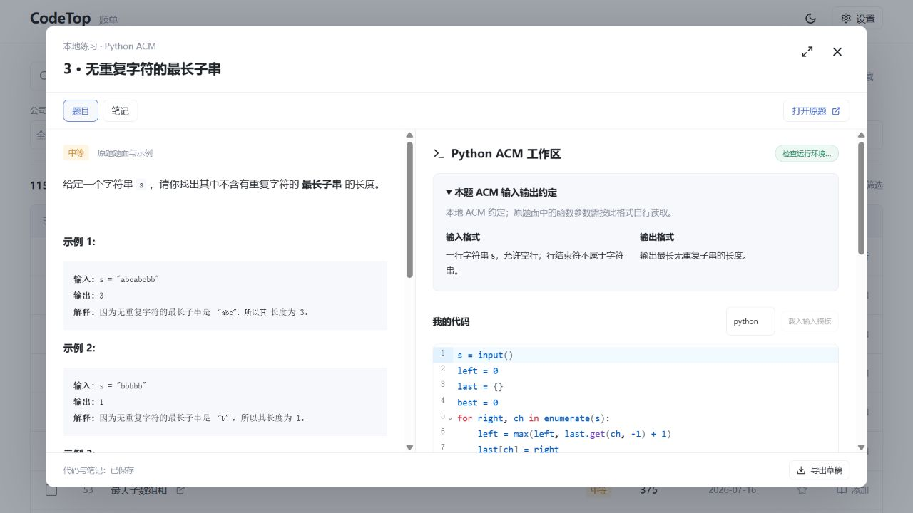

# 本地题面与 Python ACM 练习验收（2026-10-22）

应用版本 1.3.0，数据库结构保持 0002。最终发布 `releases/20261022-205450-883-13e902`，正式地址 http://127.0.0.1:8000。

## 变更

- 保留题单、全部筛选、分页、收藏、已做和原笔记入口；题名打开本地练习，独立外链图标打开来源网站。
- 原生 dialog 宽幅面板，左题面／笔记、右 Python 代码与测试，支持最大化。手机使用题目／代码与测试／笔记页签，面板保持挂载。
- 复用原有题面 HTML 清洗、笔记代码存储、测试集和 Docker 执行器；无数据库迁移、无新依赖。
- 原题参数示例与本地 ACM stdin/stdout 约定分别展示。当前 1,153 道题有 1,132 道本地题面；50 道附 152 组内置 ACM 样例／边界测试。
- 缺题面、缺样例或 Docker 不可用时明确提示；参考代码默认折叠。

## 验证结果

最终 `scripts/verify.ps1`：43 项后端测试通过，14 项前端测试通过，TypeScript 检查通过。13 项需显式启用的原 Docker／参考全集测试跳过；本次执行器与参考算法未变，不重复跑全集。保留原有 Starlette/httpx 弃用提示。生产构建通过。

新增入口和保存守卫测试先因缺少对应实现失败，再通过；独立复核发现的关闭期间再次编辑竞态补充 inert 回归测试后修复。首次沙箱内后端测试阻塞于 Windows asyncio 的 socketpair，堆栈确认后改在沙箱外运行，未修改产品逻辑绕过环境限制；本次阻塞测试与诊断进程已按身份停止。

## 独立浏览器验收

写入验收均使用 `runtime/local-practice-acceptance`、端口 8001，正式库未写入演示数据。

1. 题目 3 展示完整本地题面、原题示例和约束；ACM 区展示独立的输入输出约定。
2. 编写滑动窗口完整 Python 程序、载入样例，真实固定 Docker 镜像运行得到 1/1 通过，Python 3.12.15；运行全部内置测试得到 4/4 通过。
3. 输入代码、样例和 Markdown 笔记，关闭后重新打开内容完整；原笔记抽屉读取同一份笔记。
4. 关闭后焦点返回题名按钮；筛选和首页位置保留。最大化后宽度等于视口宽度。
5. 390×844 视口中，文档和练习面板宽度均为 390px；代码→笔记→代码切换后测试输入保留。
6. 在独立验收库制造测试 revision 冲突，手机笔记页点击关闭：面板保留、全局保存失败提示可见。移除测试冲突后点击“重试保存并关闭”，关闭成功。
7. 题目 1204 缺题面和 ACM 样例，分别显示缺失提示与原题链接，仍可编辑代码和自定义测试。
8. 实际观察 Docker 初次检查超时状态：运行按钮禁用，阅读与编辑可用，显示准备镜像命令；环境就绪后检查恢复可运行。
9. 深色主题、手机布局和最大化截图检查通过；普通运行浏览器日志未出现 error/warn。临时视口和主题已恢复。

## 复核与数据

独立只读复核发现：关闭时两种保存并行，先完成的一侧仍能继续编辑而导致最后输入丢失。已在整个保存期间将练习内容设置为 inert，键盘输入与按钮操作均暂停，失败后恢复；对应新回归测试通过。另补全所有页签都可见的保存失败提示，避免手机隐藏代码区时无法获知测试保存冲突。

正式库全部 14 张业务／版本表完整行内容的排序 JSON SHA256 与修改前逐表一致，证据为 `runtime/local-practice-baseline.json` 与 `runtime/local-practice-data-verified.json`。正式服务已加载 1.3.0；旧发布、原始快照、备份和测试产物均保留。没有批量删除或清理操作。

当前只执行 Python；其他语言可继续编辑和保存。内置测试有限，本地测试通过不等同于原题平台隐藏测试 AC。
