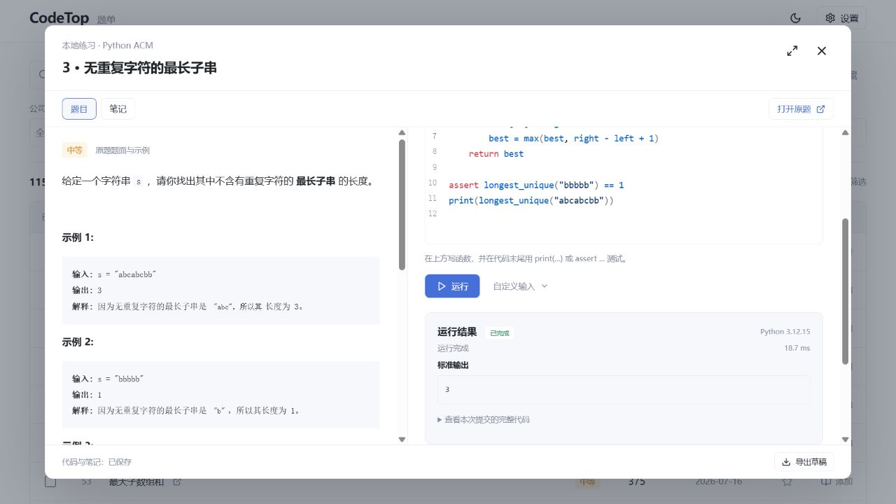

# 简化运行区验收（2026-10-22）

按用户确认的“代码编辑器＋运行＋输出”设计调整，最终前端发布 `releases/20261022-211745-458-98442d`。沿用 1.3.0 后端和 0002 数据结构，无后端、依赖或数据库变更。

## 默认使用

直接在编辑器里写函数，在末尾写函数调用、`print(...)` 或 `assert ...`，点击“运行”。结果直接显示标准输出和错误信息，不显示期望结果或通过组数。默认不传入旧的输入，不执行已保存测试。

“自定义输入”按需展开；展开时将文本作为 stdin，收起后传入空输入，原草稿仍保留。“高级测试”默认折叠，保留输入输出约定、输入模板、样例、用例名称、比较方式、期望结果、测试集与批量运行。参考实现与历史记录继续折叠。历史结果可展开查看当次输入与完整代码。

## 验证

- 测试先失败后实现：快捷运行使用空输入与 null 期望输出，可选 stdin 影响重试身份；直接展示 stdout/stderr，历史 stdin 默认折叠保留。
- 最终 `scripts/verify.ps1`：43 项后端测试、19 项前端测试及 TypeScript 检查通过。13 项旧执行器／参考全集的可选测试跳过；保留原有 Starlette/httpx 弃用提示。前端构建成功。
- 浏览器写入均在端口 8001、`runtime/local-practice-acceptance` 验收库进行。函数＋assert＋print 实际 Docker 运行输出 `3`；错误断言直接显示 `AssertionError`。
- 展开自定义输入运行 `print(input().upper())` 输出 `HELLO ACM`；收起后运行读取全部 stdin 的程序，得到空字符串，确认旧输入不会暗中传入。
- 高级测试真实运行原 4 组内置测试，4/4 通过。返回默认运行不执行测试集或比较旧期望输出。
- 最终构建关闭重开后代码完整保留，输入及高级测试默认收起；输入模板入口在高级测试中可见且不会覆盖非空代码。
- 历史运行可回看当次 `hello acm` 输入和输出，当前输入草稿不受影响。390px 手机视口无文档横向溢出，复杂控件默认收起；临时视口已恢复。浏览器无 error/warn。
- 正式 8000 页面已确认提供新的“运行”入口，未在正式库写入演示代码或用例。正式库 14 张表的完整行内容指纹均与修改前相同，证据为 `runtime/quick-run-baseline.json`、`runtime/quick-run-data-verified.json`。

独立只读复核提出输入模板入口与历史 stdin 需保留，均已补全；历史输入新增回归测试先失败后通过。旧发布与所有数据、备份、测试产物保留，无批量删除。

