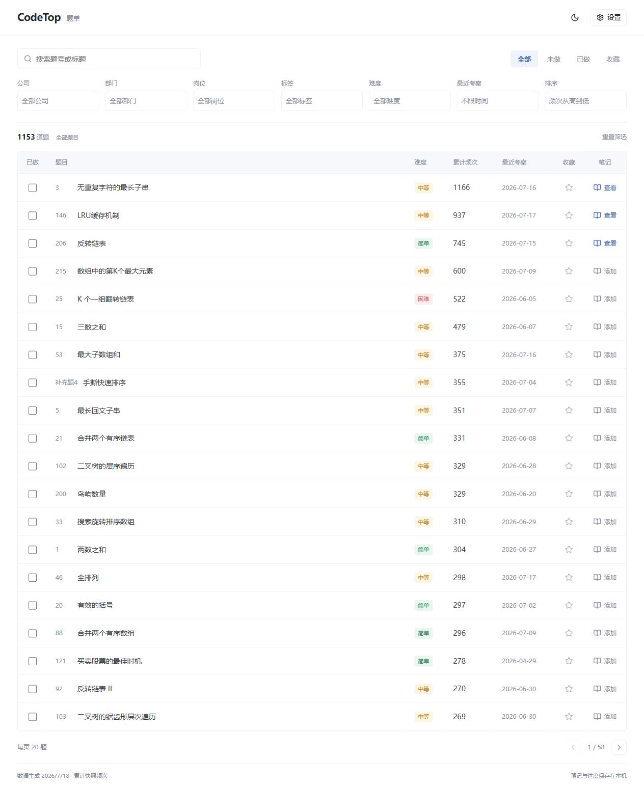

# 精简题单界面验收（2026-10-21）

用户在对话中确认 B 方案（题单＋笔记）、完整筛选项、保留参考代码查看入口，并补充“最近考察”。应用 1.2.0，数据库结构保持 0002，无 SQL 迁移。最终发布：`releases/20261021-173753-384-e11004`。

## 实际界面

- 首页为紧凑题目表格；保留搜索、公司、部门、岗位、标签、难度、最近考察与排序。公司切换清空旧部门，默认累计频次降序。
- 表格包含已做、题号/名称、难度、累计频次、最近考察日期、收藏与笔记；题名以新标签页打开 LeetCode。补充题使用来源原链接，缺少链接时明确标注。
- 全部/未做/已做/收藏四个视图；已做可勾选和取消，不伪造练习记录或启动复习。
- 右侧原生 dialog 面板提供 Markdown 编写、预览、自动保存、导出；折叠参考代码可查看、复制，不提供运行按钮。当前 50 份参考程序继续按来源内部编号匹配。
- 设置集中放置数据来源、导入预览、完整备份、恢复说明与来源版本切换。
- 主界面不再展示题面、独立代码编辑/运行、复习、掌握程度、统计卡片、热力图。原文件、所有数据库记录和旧发布保留。

## 自动验证

最终执行 `scripts/verify.ps1`：**43 项后端测试通过、8 项前端测试通过、TypeScript 检查通过**。13 项需要显式启用的旧 Docker/参考执行测试跳过；本次没有修改执行器及参考算法，未重新运行这些测试。构建成功，笔记懒加载分块仍有大于 500 kB 的构建提示，非构建失败；首页 JS 约 208 kB（未压缩）。测试客户端保留原有弃用提示。

新增进度测试在实现前因接口尚不接受 done 而全部失败；实现后通过。覆盖勾选/取消、旧练习与复习记录保留、陈旧 revision 冲突、收藏与进度相互独立，以及备份恢复/重启后手动标记仍然有效。手动标记通过已有 settings 表中的 completion:<题目 UUID> 保存，继续参与完整数据库备份，无需改变旧表。

前端测试验证公司变化清空部门、所有筛选参数（含最近考察）传入 API、收藏视图、官方与补充题链接准确标注、缺失/不安全链接不被猜测生成。

## 浏览器验收

全部写入及故障测试使用独立目录 `runtime/simple-ui-acceptance`、端口 8001；正式库未写入演示数据。

- 题名为真实 LeetCode 超链接；公司/部门联动、最近三个月/半年、组合筛选、完成与收藏视图、设置入口均进行了实际操作。
- 保存笔记后关闭再打开内容完整，Markdown 预览正常；完整参考实现可展开并复制，未展示本地运行或题面。
- 验收库准备 21 条收藏后，进入第 2 页取消唯一一条收藏；列表自动回到第 1 页，最终显示 20 道、1/1 页。
- 勾选已做后只在已做视图出现；取消后离开已做列表，未创建练习记录。
- 关闭笔记后，键盘焦点返回原笔记按钮。
- 390×844 视口下，文档宽度等于可用宽度，表格在自身容器横向滚动；笔记面板左边界为 0，宽度等于可用宽度。临时视口覆盖已恢复。
- 验收库预先保留一段 C++ 代码，再仅通过界面修改 Markdown，确认 code_text 和 language=cpp 完整保留。

## 独立复核与故障回归

独立只读复核发现两项 Important 和一项分页边界问题，均已修复并复核无遗留 Important/Critical。

1. 首次懒加载笔记资源失败原先会清空 React 根界面。通过停止独立服务并点击笔记实际复现；增加模块外错误边界后，同样故障下题单仍可见，显示刷新与返回入口。
2. 预览资源失败原先会卸载持有草稿与关闭守卫的整个 NoteContent。通过停止独立服务、输入未保存文字、点击未加载预览实际复现；改为草稿/关闭守卫/导出控件位于组件边界外，编辑/预览和参考显示单独保护。修复后故障下文字与导出入口保留，保存失败会阻止关闭；恢复服务后保存、关闭、重开文字完整。
3. 收藏数量从 21 降为 20 时，依据最新总数收敛页码，避免显示 2/1 页与错误空列表。

故障测试的控制台错误来自有意停止独立服务，不作为普通运行错误遗漏；这些故障不涉及正式 8000 服务。

## 正式数据保留

更新前备份：`data/backups/20261021T091308913578Z-manual-5c5c3828.zip`。逐表基线：`runtime/simple-ui-baseline-20261021T091307.json`。更新后验证：`runtime/simple-ui-data-verified.json`。

对正式库 **全部 14 张业务/版本表**的完整行排序后计算 JSON SHA256，与更新前逐表一致。包括 3 条笔记、1 条运行记录、2 份测试集，以及原题库/来源/学习数据；练习、学习状态和设置仍各为 0。未在文档复制用户笔记正文或独立代码。

没有批量删除、目录清理、Docker prune 或卸载操作。旧界面、运行器、参考代码、日志、验收数据、备份及发布全部保留。

最终截图检查还发现上游全局 th/td 的六列百分比宽度挤压了新增第七列。已用更明确的局部列宽覆盖；正式页面确认笔记列宽 84px，首行笔记按钮位于表格可见边界内。最终截图：

